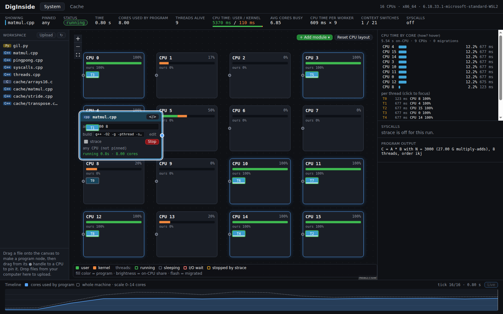
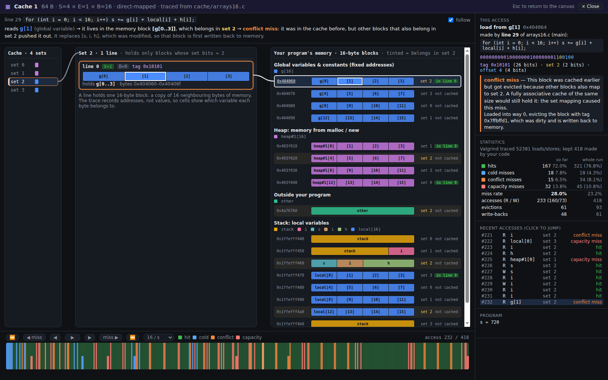
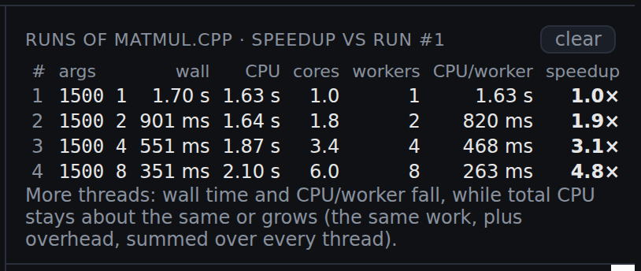
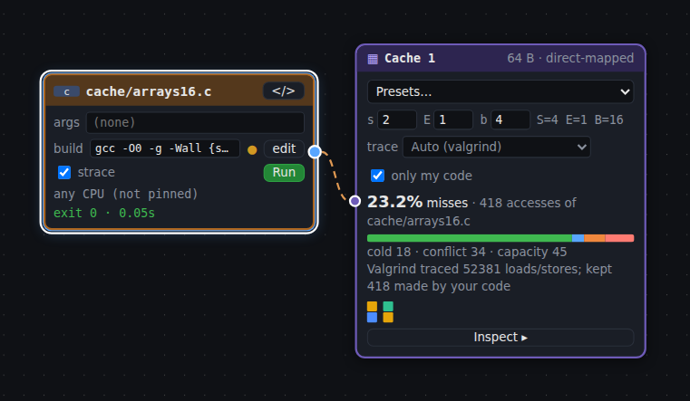

# DigInside

A visual playground for how programs use the machine, built for courses like CS 354 (Machine Organization and Programming).

- **Threads on cores.** Run a program and watch its threads land on CPU cores, migrate, and compete. Pin programs to cores by drawing edges, and compare runs to see parallel speedup.
- **Cache, access by access.** Connect a program to a simulated cache and step through every load and store: which set it maps to, whether it hits or misses (cold, conflict or capacity), and which of your variables each cache line holds.




| Parallel speedup across runs | A program feeding a cache module |
|---|---|
|  |  |

---

## Platforms

| | |
|---|---|
| **Linux** | Fully supported (native hardware CPUs). |
| **Windows** | Run the backend inside **WSL2**; open the page in any Windows browser. Cores shown are WSL's virtual CPUs. |
| **macOS** | Not natively: no `/proc`, no `strace`, no way to pin threads to cores, and no Valgrind on Apple Silicon. Run it inside a Linux VM (UTM, Lima, OrbStack). |

DigInside adapts to the machine: it draws one node per CPU the backend is allowed to use (`sched_getaffinity`), and the "Your CPU's L1d" cache preset comes from `/sys/devices/system/cpu/cpu0/cache`.

## Quick start

Linux (or WSL2) with:

| Tool | Why | Ubuntu package |
|---|---|---|
| Python ≥ 3.9 | backend | `python3 python3-venv` |
| Node ≥ 18 (Linux build, not the Windows one) | frontend | via [nvm](https://github.com/nvm-sh/nvm) |
| gcc / g++ | compiling your programs | `build-essential` |
| strace | syscall tracing | `strace` |
| valgrind | tracing real machine-code memory accesses | `valgrind` |
| taskset, readelf, nm, addr2line | CPU pinning, debug info | `util-linux binutils` (usually preinstalled) |

```bash
# backend
cd backend
python3 -m venv .venv
.venv/bin/pip install -r requirements.txt
./run.sh                      # http://127.0.0.1:8000

# frontend (second terminal)
cd frontend
npm install
npm run dev                   # open http://localhost:5173
```

> **WSL users:** if `which npm` points to `/mnt/c/...`, you're using Windows' npm, which breaks native packages. Install Node inside Linux with nvm.

---

## Using it

1. **Drop a program on the canvas.** The left sidebar lists `workspace/`. Drag a file onto the canvas to make a program node, then press **Run**. Upload your own files with **Upload** or by dropping them on the sidebar.
2. **Pin it to cores.** Drag from the program's **●** handle to a CPU node. Each edge is an allowed core; change edges while it runs and its threads move. **unpin all** clears them.
3. **Read the stats.** The top bar shows wall time, user vs kernel CPU time, **avg cores busy** (CPU ÷ wall) and **CPU time per worker thread**. The right side shows CPU time by core, the syscall stream, program output, and a **run history** for comparing runs (e.g. 1 / 2 / 4 / 8 threads).
4. **Add a cache.** **+ Add module → Cache**. Pick a geometry (or **Your CPU's L1d**), connect a program to it, and press Run on the program. The cache node fills in; **Inspect** opens the step-through view.
5. **Step through memory.** Use → / ← to step, Shift+→ to jump to the next miss, and Space to play. Each step is explained in one sentence; the three columns show sets, the lines of the selected set, and your program's memory, wired together.

**Example programs** in `workspace/`:

| File | Shows |
|---|---|
| `threads.cpp` | `4 3 spin`: N threads on N cores; without `spin`: sleeping vs running threads |
| `matmul.cpp` | parallel speedup (`2000 1` vs `2000 8`) and loop order (`1024 1 ikj` / `ijk` / `jki`) on real hardware |
| `gil.py` | Python threads take turns on one core (the GIL) |
| `syscalls.cpp` | cost of crossing into the kernel (`64 3` vs `1048576 3`), with and without strace |
| `pingpong.cpp` | cross-core wakeups: pin to 1 core vs 2 |
| `cache/arrays16.c` | plain C, traced with Valgrind: globals, stack and heap in a tiny cache |
| `cache/matmul.cpp`, `cache/transpose.cpp`, `cache/stride.cpp` | classic cache lessons using `tarray.hpp` |

A file can suggest its own defaults in its first comments:
```c
// args: 64 naive 4 0
// cache: 5 1 5          (s E b: 2^5 sets, 1 line per set, 2^5-byte blocks)
```

---

## How the cache gets its trace

A cache node can be fed in two ways (its **Trace** setting; *Auto* picks for you):

- **Source arrays (`instrument/tarray.hpp`).** Use `dig::tarray<T>` / `dig::tmatrix<T>` instead of plain arrays, and every element access is logged. Traces are clean, named and identical on every run. Addresses come from a simulated address space, which keeps each array's real layout.
  ```cpp
  #include "tarray.hpp"
  dig::tarray<int> a(1024, "a");   // logs every a[i] read and write
  { dig::Untraced quiet; /* initialization isn't traced */ }
  dig::mark("phase 2");            // labels the timeline
  ```
- **Machine code (Valgrind).** Any C/C++ program, unmodified. It runs under `valgrind --tool=lackey`, keeps only loads and stores made by your own code, and names them from the debug info (globals, `main`'s locals, heap blocks from the line that called `malloc`). Addresses are the real virtual addresses of a `-no-pie` build. It's about 50× slower, and it shows what the compiler actually emitted (e.g. 16-byte SIMD stores at `-O2`).

The simulator (`backend/cache_sim.py`) is a set-associative cache with LRU replacement and write-back + write-allocate. It classifies each miss using a fully associative shadow cache of the same size. It reproduces the CS:APP Cache Lab handout's `yi.trace` example access by access.

---

## What the numbers are (and aren't)

- **Sampling.** Thread placement and CPU time are sampled from `/proc` every 50 ms. On-CPU time is exact (from `schedstat`), but "time per core" is estimated: a thread that migrates mid-sample has that slice credited to its new core. Threads that live less than 50 ms can be missed.
- **strace slows programs down.** Each syscall stops the program twice, so syscall-heavy programs slow down a lot. Turn strace off on the program node for timing.
- **WSL2 has virtual CPUs.** There, "CPU 3" is a virtual CPU that the Windows hypervisor moves between physical cores, so pinning pins to a vCPU. On native Linux, CPU numbers are real hardware threads.
- **The cache is a simulation, not a hardware measurement.** It uses the geometry you choose, or your CPU's real L1d (from `/sys`), with ideal LRU and no prefetching. Small caches make effects visible in traces short enough to step through.
- **Addresses depend on the tracer and the build.** In Valgrind traces, globals have fixed addresses (`-no-pie`), but the stack and heap differ from a normal run, which Linux randomizes.
- **No sandbox.** Programs run as your user. Run only code you trust, and don't expose the backend beyond localhost (it binds to 127.0.0.1).

---

## Project layout

```
backend/
  main.py            FastAPI app: file API, WS /ws/system, POST /run_cache
  system_monitor.py  launch, /proc sampling, strace parsing, CPU pinning
  workspace.py       workspace files, on-demand compilation, header hints
  cache_sim.py       cache simulator (also a CLI)
  runner.py          tarray traces: compile, run, cache traces
  vgtrace.py         Valgrind traces: filtering, DWARF variable names, source lines
  try_system.py      terminal client for System mode
  try_cache.py       terminal client for Cache mode
instrument/
  tarray.hpp         traced array types
  heapshim.c         malloc logger preloaded under Valgrind
frontend/src/        React app (canvas, cache explorer, panels)
workspace/           your programs; cache/ holds cache examples
```

Terminal clients, handy for testing without the UI:
```bash
backend/.venv/bin/python backend/try_system.py --file threads.cpp --args "4 2 spin" --cpus 0,1
backend/.venv/bin/python backend/try_cache.py cache/arrays16.c "" --origin workspace --tracer valgrind -s 2 -E 1 -b 4 -v
```

## Troubleshooting

- **Page says "Backend unreachable":** start `backend/run.sh` (port 8000). To use a different backend port: `DIGINSIDE_BACKEND_PORT=8100 npm run dev`.
- **Styles look stale after editing CSS:** refresh. If that doesn't help, restart `npm run dev` (WSL file watching occasionally misses an edit).
- **A cache says "doesn't use tarray.hpp":** set its Trace to *Auto* or *Machine code (Valgrind)*.
